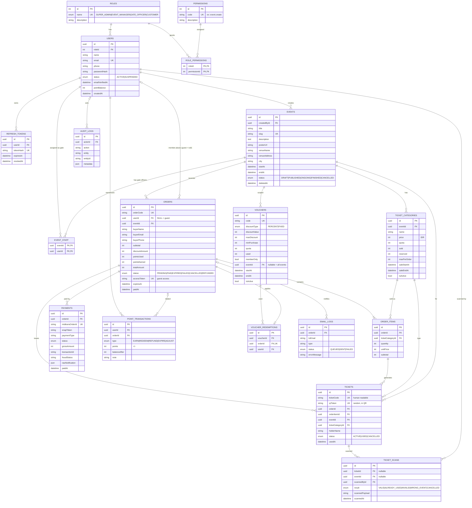

# ERD — EventTixx

Database: **PostgreSQL (Aiven)** · ORM: **Prisma**
Render diagram Mermaid di GitHub / VS Code (ekstensi Markdown Preview Mermaid) / https://mermaid.live

---

## 1. Diagram ERD



---

## 2. Kamus Data Singkat (tabel kunci)

| Tabel | Catatan penting |
|---|---|
| `users` | **Hanya Member & staff.** Guest TIDAK ada di sini. |
| `orders` | `userId` NULL = Guest. `buyerName/Email/Phone` selalu terisi (snapshot). `accessToken` untuk Guest membuka tiket. |
| `ticket_categories` | `sold` = sudah PAID, `reserved` = order PENDING. Constraint `sold + reserved <= quota`. |
| `payments` | 1 order bisa >1 payment (retry). `midtransOrderId` dikirim ke Midtrans sebagai `order_id` (format: `orderCode-<attempt>`). |
| `tickets` | 1 baris per tiket fisik/digital. `qrToken` yang masuk ke QR — **bukan** `id`. |
| `ticket_scans` | Log SEMUA percobaan scan (valid maupun gagal). |
| `point_transactions` | Ledger poin. `users.pointBalance` = cache saldo; selalu update dalam transaksi yang sama. |
| `event_staff` | Penugasan Gate Officer ke event. |

## 3. Constraint & Index Tambahan (jalankan via migration SQL)

Prisma tidak mendukung CHECK constraint secara native. Tambahkan lewat migration kustom:

```sql
-- Anti overselling (lapis kedua selain logika aplikasi)
ALTER TABLE "ticket_categories"
  ADD CONSTRAINT chk_stock CHECK (sold >= 0 AND reserved >= 0 AND sold + reserved <= quota);

ALTER TABLE "orders"
  ADD CONSTRAINT chk_order_amount CHECK ("totalAmount" >= 0 AND "subtotal" >= 0);

ALTER TABLE "users"
  ADD CONSTRAINT chk_points CHECK ("pointBalance" >= 0);
```

Cara: `npx prisma migrate dev --create-only --name add_checks`, lalu tempel SQL di file migration yang dihasilkan, kemudian `npx prisma migrate dev`.

Index penting sudah ada di schema (`@@index`). Untuk monitoring, query sering memakai: `orders(status, createdAt)`, `orders(buyerEmail)`, `tickets(qrToken)`, `events(status, startAt)`.

---

## 4. Seed Data Wajib

**Roles:** `SUPER_ADMIN`, `EVENT_MANAGER`, `GATE_OFFICER`, `CUSTOMER`

**Permissions** (lihat matriks di PRD §3):
```
event.view_public, event.create, event.update, event.delete,
ticket_category.manage, voucher.manage,
order.create, order.view_own, order.view_event, order.view_all,
ticket.view_own, ticket.scan, point.use,
user.manage, role.manage, permission.manage,
report.view_all, report.view_event, audit_log.view
```

**User awal:** 1 Super Admin (`admin@eventtixx.com`, password dari env `SEED_ADMIN_PASSWORD`), serta data demo: 1 Event Manager, 1 Gate Officer, 1 Customer, 2 event dengan 3 kategori tiket.

---

## 5. Prisma Schema Lengkap

Salin ke `backend/prisma/schema.prisma`. Setelah itu jalankan `npx prisma validate` untuk memastikan valid.

```prisma
generator client {
  provider = "prisma-client-js"
}

datasource db {
  provider = "postgresql"
  url      = env("DATABASE_URL")
}

// ───────────── ENUMS ─────────────
enum RoleName {
  SUPER_ADMIN
  EVENT_MANAGER
  GATE_OFFICER
  CUSTOMER
}

enum UserStatus {
  ACTIVE
  SUSPENDED
}

enum EventStatus {
  DRAFT
  PUBLISHED
  ONGOING
  FINISHED
  CANCELLED
}

enum OrderStatus {
  PENDING
  PAID
  EXPIRED
  FAILED
  CANCELLED
  REFUNDED
}

enum PaymentStatus {
  PENDING
  SETTLEMENT
  DENIED
  EXPIRED
  CANCELLED
  FAILED
  REFUNDED
}

enum TicketStatus {
  ACTIVE
  USED
  CANCELLED
}

enum ScanResult {
  VALID
  ALREADY_USED
  INVALID
  WRONG_EVENT
  CANCELLED
}

enum PointType {
  EARN
  REDEEM
  REFUND
  EXPIRE
  ADJUST
}

enum DiscountType {
  PERCENT
  FIXED
}

enum EmailStatus {
  QUEUED
  SENT
  FAILED
}

// ───────────── RBAC ─────────────
model Role {
  id          Int              @id @default(autoincrement())
  name        RoleName         @unique
  description String?
  users       User[]
  permissions RolePermission[]

  @@map("roles")
}

model Permission {
  id          Int              @id @default(autoincrement())
  code        String           @unique
  description String?
  roles       RolePermission[]

  @@map("permissions")
}

model RolePermission {
  roleId       Int
  permissionId Int
  role         Role       @relation(fields: [roleId], references: [id], onDelete: Cascade)
  permission   Permission @relation(fields: [permissionId], references: [id], onDelete: Cascade)

  @@id([roleId, permissionId])
  @@map("role_permissions")
}

// ───────────── USERS ─────────────
model User {
  id              String    @id @default(uuid())
  roleId          Int
  name            String
  email           String    @unique
  phone           String?
  passwordHash    String
  status          UserStatus @default(ACTIVE)
  emailVerifiedAt DateTime?
  pointBalance    Int       @default(0)
  createdAt       DateTime  @default(now())
  updatedAt       DateTime  @updatedAt

  role              Role               @relation(fields: [roleId], references: [id])
  refreshTokens     RefreshToken[]
  eventsCreated     Event[]            @relation("EventCreator")
  staffAssignments  EventStaff[]
  orders            Order[]
  scans             TicketScan[]
  pointTransactions PointTransaction[]
  voucherRedemptions VoucherRedemption[]
  vouchersCreated   Voucher[]          @relation("VoucherCreator")
  auditLogs         AuditLog[]

  @@index([roleId])
  @@map("users")
}

model RefreshToken {
  id        String    @id @default(uuid())
  userId    String
  tokenHash String    @unique
  expiresAt DateTime
  revokedAt DateTime?
  createdAt DateTime  @default(now())

  user User @relation(fields: [userId], references: [id], onDelete: Cascade)

  @@index([userId])
  @@map("refresh_tokens")
}

// ───────────── EVENTS ─────────────
model Event {
  id           String      @id @default(uuid())
  createdById  String
  title        String
  slug         String      @unique
  description  String?     @db.Text
  posterUrl    String?
  venueName    String
  venueAddress String?
  city         String
  startAt      DateTime
  endAt        DateTime?
  status       EventStatus @default(DRAFT)
  deletedAt    DateTime?
  createdAt    DateTime    @default(now())
  updatedAt    DateTime    @updatedAt

  createdBy  User             @relation("EventCreator", fields: [createdById], references: [id])
  categories TicketCategory[]
  staff      EventStaff[]
  orders     Order[]
  tickets    Ticket[]
  vouchers   Voucher[]
  scans      TicketScan[]

  @@index([status, startAt])
  @@index([city])
  @@map("events")
}

model EventStaff {
  eventId   String
  userId    String
  createdAt DateTime @default(now())

  event Event @relation(fields: [eventId], references: [id], onDelete: Cascade)
  user  User  @relation(fields: [userId], references: [id], onDelete: Cascade)

  @@id([eventId, userId])
  @@map("event_staff")
}

model TicketCategory {
  id          String    @id @default(uuid())
  eventId     String
  name        String
  description String?
  price       Int
  quota       Int
  sold        Int       @default(0)
  reserved    Int       @default(0)
  maxPerOrder Int       @default(5)
  saleStartAt DateTime?
  saleEndAt   DateTime?
  isActive    Boolean   @default(true)
  createdAt   DateTime  @default(now())
  updatedAt   DateTime  @updatedAt

  event      Event       @relation(fields: [eventId], references: [id], onDelete: Cascade)
  orderItems OrderItem[]
  tickets    Ticket[]

  @@index([eventId])
  @@map("ticket_categories")
}

// ───────────── ORDERS & PAYMENTS ─────────────
model Order {
  id             String      @id @default(uuid())
  orderCode      String      @unique
  userId         String?     // NULL = Guest
  eventId        String
  buyerName      String
  buyerEmail     String
  buyerPhone     String
  subtotal       Int
  discountAmount Int         @default(0)
  pointsUsed     Int         @default(0)
  pointsEarned   Int         @default(0)
  totalAmount    Int
  status         OrderStatus @default(PENDING)
  accessToken    String      @unique
  expiresAt      DateTime
  paidAt         DateTime?
  createdAt      DateTime    @default(now())
  updatedAt      DateTime    @updatedAt

  user               User?               @relation(fields: [userId], references: [id])
  event              Event               @relation(fields: [eventId], references: [id])
  items              OrderItem[]
  payments           Payment[]
  tickets            Ticket[]
  pointTransactions  PointTransaction[]
  voucherRedemption  VoucherRedemption?
  emailLogs          EmailLog[]

  @@index([status, createdAt])
  @@index([buyerEmail])
  @@index([userId])
  @@index([eventId, status])
  @@index([status, expiresAt])
  @@map("orders")
}

model OrderItem {
  id               String @id @default(uuid())
  orderId          String
  ticketCategoryId String
  quantity         Int
  unitPrice        Int
  subtotal         Int

  order          Order          @relation(fields: [orderId], references: [id], onDelete: Cascade)
  ticketCategory TicketCategory @relation(fields: [ticketCategoryId], references: [id])
  tickets        Ticket[]

  @@index([orderId])
  @@map("order_items")
}

model Payment {
  id              String        @id @default(uuid())
  orderId         String
  midtransOrderId String        @unique
  snapToken       String?
  redirectUrl     String?
  paymentType     String?
  transactionId   String?
  fraudStatus     String?
  status          PaymentStatus @default(PENDING)
  grossAmount     Int
  rawNotification Json?
  paidAt          DateTime?
  createdAt       DateTime      @default(now())
  updatedAt       DateTime      @updatedAt

  order Order @relation(fields: [orderId], references: [id], onDelete: Cascade)

  @@index([orderId])
  @@index([status])
  @@map("payments")
}

// ───────────── TICKETS & SCAN ─────────────
model Ticket {
  id               String       @id @default(uuid())
  ticketCode       String       @unique
  qrToken          String       @unique
  orderId          String
  orderItemId      String
  eventId          String
  ticketCategoryId String
  holderName       String?
  status           TicketStatus @default(ACTIVE)
  usedAt           DateTime?
  createdAt        DateTime     @default(now())

  order          Order          @relation(fields: [orderId], references: [id])
  orderItem      OrderItem      @relation(fields: [orderItemId], references: [id])
  event          Event          @relation(fields: [eventId], references: [id])
  ticketCategory TicketCategory @relation(fields: [ticketCategoryId], references: [id])
  scans          TicketScan[]

  @@index([orderId])
  @@index([eventId, status])
  @@map("tickets")
}

model TicketScan {
  id             String     @id @default(uuid())
  ticketId       String?
  eventId        String?
  scannedById    String
  result         ScanResult
  scannedPayload String
  deviceInfo     String?
  scannedAt      DateTime   @default(now())

  ticket    Ticket? @relation(fields: [ticketId], references: [id])
  event     Event?  @relation(fields: [eventId], references: [id])
  scannedBy User    @relation(fields: [scannedById], references: [id])

  @@index([ticketId])
  @@index([eventId, scannedAt])
  @@map("ticket_scans")
}

// ───────────── POINTS & VOUCHERS ─────────────
model PointTransaction {
  id           String    @id @default(uuid())
  userId       String
  orderId      String?
  type         PointType
  points       Int       // positif = tambah, negatif = kurang
  balanceAfter Int
  note         String?
  createdAt    DateTime  @default(now())

  user  User   @relation(fields: [userId], references: [id])
  order Order? @relation(fields: [orderId], references: [id])

  @@index([userId, createdAt])
  @@map("point_transactions")
}

model Voucher {
  id            String       @id @default(uuid())
  code          String       @unique
  description   String?
  discountType  DiscountType
  discountValue Int          // PERCENT: 1-100, FIXED: Rupiah
  maxDiscount   Int?
  minPurchase   Int          @default(0)
  quota         Int?
  used          Int          @default(0)
  memberOnly    Boolean      @default(false)
  eventId       String?
  startAt       DateTime
  endAt         DateTime
  isActive      Boolean      @default(true)
  createdById   String
  createdAt     DateTime     @default(now())

  event       Event?              @relation(fields: [eventId], references: [id])
  createdBy   User                @relation("VoucherCreator", fields: [createdById], references: [id])
  redemptions VoucherRedemption[]

  @@map("vouchers")
}

model VoucherRedemption {
  id        String   @id @default(uuid())
  voucherId String
  orderId   String   @unique
  userId    String?
  createdAt DateTime @default(now())

  voucher Voucher @relation(fields: [voucherId], references: [id])
  order   Order   @relation(fields: [orderId], references: [id])
  user    User?   @relation(fields: [userId], references: [id])

  @@map("voucher_redemptions")
}

// ───────────── LOGS ─────────────
model EmailLog {
  id           String      @id @default(uuid())
  orderId      String?
  toEmail      String
  type         String      // TICKET | WELCOME | RESET_PASSWORD | VERIFY_EMAIL
  subject      String
  status       EmailStatus @default(QUEUED)
  errorMessage String?
  sentAt       DateTime?
  createdAt    DateTime    @default(now())

  order Order? @relation(fields: [orderId], references: [id])

  @@index([status])
  @@index([orderId])
  @@map("email_logs")
}

model AuditLog {
  id        String   @id @default(uuid())
  actorId   String?
  action    String
  entity    String
  entityId  String?
  metadata  Json?
  ipAddress String?
  createdAt DateTime @default(now())

  actor User? @relation(fields: [actorId], references: [id])

  @@index([entity, entityId])
  @@index([createdAt])
  @@map("audit_logs")
}
```

> **Catatan untuk agent:** relasi `User` ↔ `Voucher`/`VoucherRedemption` harus lengkap di kedua sisi agar `prisma validate` lolos. Jika ada error relasi, perbaiki sisi yang kurang, **jangan** menghapus relasi.
