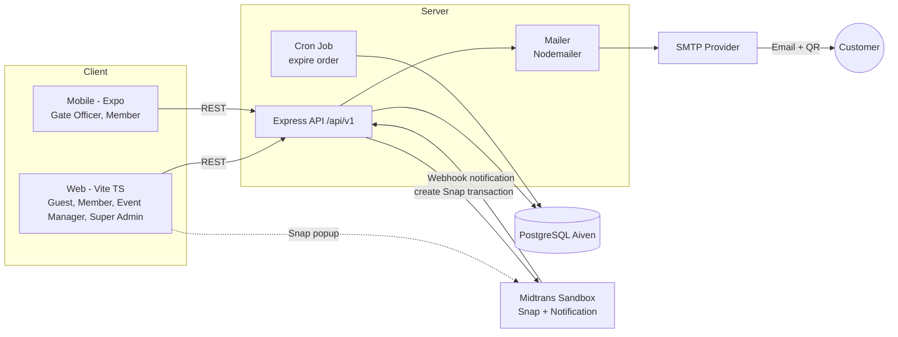
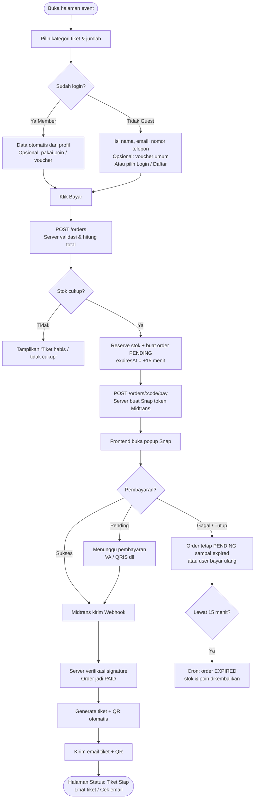
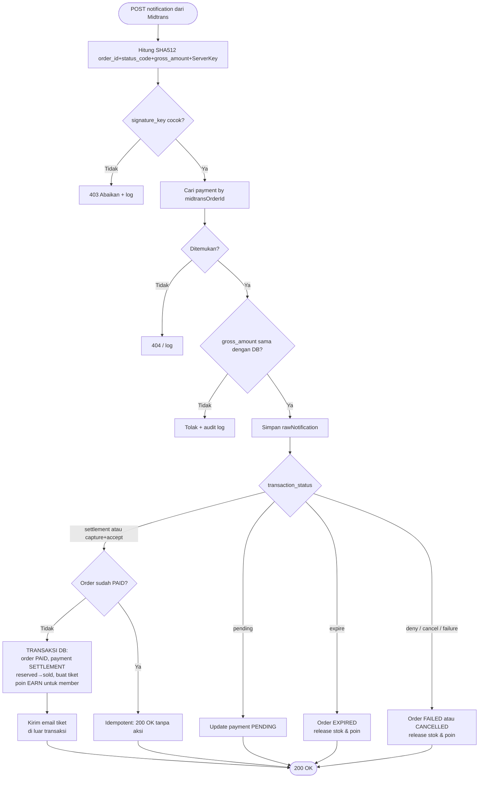
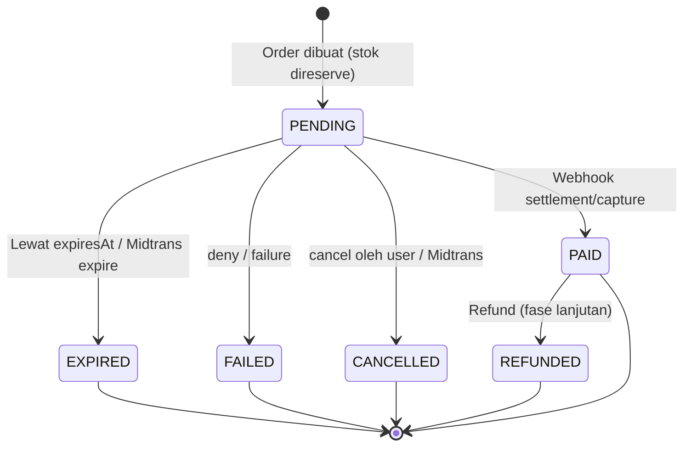
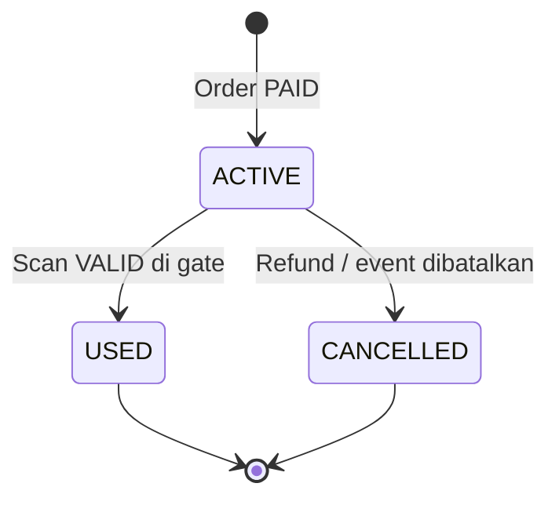
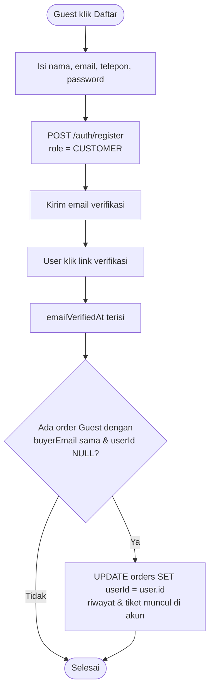
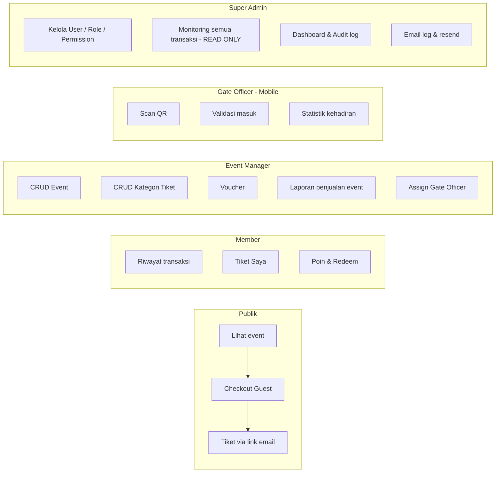

# FLOW — EventTixx

Semua diagram memakai Mermaid. Render di GitHub / VS Code / https://mermaid.live

---

## 1. Arsitektur Sistem



---

## 2. Alur Pembelian Tiket (Guest & Member)



---

## 3. Sequence — Checkout Guest sampai Tiket Terkirim

```mermaid
sequenceDiagram
    autonumber
    actor G as Guest
    participant FE as Web (Vite)
    participant BE as Express API
    participant DB as PostgreSQL
    participant MT as Midtrans Sandbox
    participant ML as SMTP

    G->>FE: Pilih tiket + isi nama/email/telepon
    FE->>BE: POST /orders {eventId, items, buyer}
    BE->>DB: BEGIN; lock kategori; cek stok
    BE->>DB: reserved += qty; insert order(PENDING) + items
    BE->>DB: COMMIT
    BE-->>FE: {orderCode, accessToken, totalAmount}
    FE->>BE: POST /orders/:code/pay
    BE->>MT: Snap createTransaction(order_id, gross_amount, customer, expiry)
    MT-->>BE: {token, redirect_url}
    BE->>DB: insert payment(PENDING, snapToken)
    BE-->>FE: {snapToken}
    FE->>MT: snap.pay(snapToken) (popup)
    G->>MT: Bayar (sandbox)
    MT-->>BE: POST /payments/midtrans/notification
    BE->>BE: Verifikasi signature_key & gross_amount
    BE->>DB: BEGIN; order PAID; reserved->sold; payment SETTLEMENT
    BE->>DB: insert tickets (qrToken acak) ; COMMIT
    BE->>ML: Kirim email (QR + link tiket)
    BE->>DB: email_logs SENT/FAILED
    BE-->>MT: 200 OK
    FE->>BE: Polling GET /orders/:code/status
    BE-->>FE: {status: PAID}
    FE-->>G: Tampilkan "Pembayaran berhasil, tiket dikirim ke email"
```

---

## 4. Penanganan Webhook Midtrans (Idempotent)



---

## 5. Status Order (State Machine)



## 5b. Status Tiket



---

## 6. Alur Scan Gate Officer (Mobile)

```mermaid
flowchart TD
    A([Gate Officer login di app]) --> B[Pilih event yang ditugaskan]
    B --> C[Buka kamera scanner]
    C --> D[Scan QR -> dapat qrToken]
    D --> E[POST /gate/scan {eventId, qrToken}]
    E --> F{Officer ditugaskan<br/>di event ini?}
    F -- Tidak --> X0[403 Forbidden]
    F -- Ya --> G{Tiket dengan qrToken ada?}
    G -- Tidak --> R1[INVALID ❌<br/>log scan]
    G -- Ya --> H{ticket.eventId = eventId?}
    H -- Tidak --> R2[WRONG_EVENT ❌]
    H -- Ya --> I{Status tiket}
    I -- CANCELLED --> R3[CANCELLED ❌]
    I -- USED --> R4[ALREADY_USED ⚠️<br/>tampilkan waktu & petugas sebelumnya]
    I -- ACTIVE --> J[TRANSAKSI: UPDATE tickets SET USED<br/>WHERE id AND status=ACTIVE]
    J --> K{Baris ter-update = 1?}
    K -- Tidak, race condition --> R4
    K -- Ya --> R5[VALID ✅<br/>tampilkan kategori & pemegang]
    R1 --> L[Catat ticket_scans]
    R2 --> L
    R3 --> L
    R4 --> L
    R5 --> L
    L --> C
```

---

## 7. Reservasi & Pengembalian Stok

```mermaid
sequenceDiagram
    participant API as Express API
    participant DB as PostgreSQL
    participant CR as Cron (tiap 1 menit)

    Note over API,DB: Saat order dibuat
    API->>DB: UPDATE ticket_categories SET reserved = reserved + :qty<br/>WHERE id = :id AND sold + reserved + :qty <= quota
    DB-->>API: rowCount (0 = stok tidak cukup → batal)

    Note over API,DB: Saat PAID
    API->>DB: SET reserved = reserved - :qty, sold = sold + :qty

    Note over CR,DB: Order kadaluarsa
    CR->>DB: SELECT orders WHERE status=PENDING AND expiresAt < now()
    CR->>DB: order EXPIRED; reserved = reserved - :qty; poin dikembalikan
```

---

## 8. Alur Registrasi Member & Klaim Order Guest



---

## 9. Hak Akses per Role (Navigasi)



---

## 10. Daftar Endpoint API (ringkas)

Prefix `/api/v1`. 🔓 publik · 🔐 perlu login · 🛡 perlu permission tertentu.

### Auth
| Method | Path | Akses |
|---|---|---|
| POST | `/auth/register` | 🔓 |
| POST | `/auth/login` | 🔓 |
| POST | `/auth/refresh` | 🔓 |
| POST | `/auth/logout` | 🔐 |
| POST | `/auth/forgot-password` · `/auth/reset-password` | 🔓 |
| GET  | `/auth/verify-email?token=` | 🔓 |
| GET  | `/me` · PATCH `/me` | 🔐 |

### Event (publik)
| GET | `/events` (search, city, date, page) | 🔓 |
| GET | `/events/:slug` | 🔓 |

### Event Management
| POST/PATCH/DELETE | `/manage/events` · `/manage/events/:id` | 🛡 `event.*` |
| GET | `/manage/events` (milik sendiri) | 🛡 |
| POST/PATCH/DELETE | `/manage/events/:id/categories` | 🛡 `ticket_category.manage` |
| POST/DELETE | `/manage/events/:id/staff` | 🛡 |
| GET | `/manage/events/:id/sales` | 🛡 `report.view_event` |
| CRUD | `/manage/vouchers` | 🛡 `voucher.manage` |

### Order & Payment
| POST | `/orders` (guest/member) | 🔓 (token opsional) |
| POST | `/orders/:orderCode/pay` | 🔓 + `accessToken` atau pemilik |
| GET | `/orders/:orderCode/status` | 🔓 + `accessToken` atau pemilik |
| POST | `/orders/:orderCode/sync` | 🔓 + `accessToken` atau pemilik |
| POST | `/orders/lookup` {orderCode, email} | 🔓 |
| GET | `/me/orders` · `/me/orders/:code` | 🔐 |
| POST | `/payments/midtrans/notification` | 🔓 **(verifikasi signature)** |

### Tiket
| GET | `/tickets/by-token?token=<accessToken>` | 🔓 (guest) |
| GET | `/me/tickets` | 🔐 |
| POST | `/orders/:orderCode/resend-email` | 🔓 + akses order |

### Poin & Voucher
| GET | `/me/points` | 🔐 |
| POST | `/vouchers/validate` {code, eventId, subtotal} | 🔓 |

### Gate
| GET | `/gate/events` (event yang ditugaskan) | 🛡 `ticket.scan` |
| POST | `/gate/scan` {eventId, qrToken} | 🛡 `ticket.scan` |
| POST | `/gate/scan-manual` {eventId, ticketCode} | 🛡 `ticket.scan` |
| GET | `/gate/events/:id/stats` | 🛡 `ticket.scan` |

### Super Admin
| CRUD | `/admin/users` | 🛡 `user.manage` |
| CRUD | `/admin/roles` · `/admin/permissions` | 🛡 `role.manage` |
| GET | `/admin/orders` (filter/search) · `/admin/orders/:id` | 🛡 `order.view_all` |
| GET | `/admin/payments` | 🛡 `order.view_all` |
| GET | `/admin/dashboard` | 🛡 `report.view_all` |
| GET | `/admin/email-logs` · POST `/admin/email-logs/:id/resend` | 🛡 |
| GET | `/admin/audit-logs` | 🛡 `audit_log.view` |

> ⚠️ **Tidak ada** endpoint approve/reject pembayaran.
